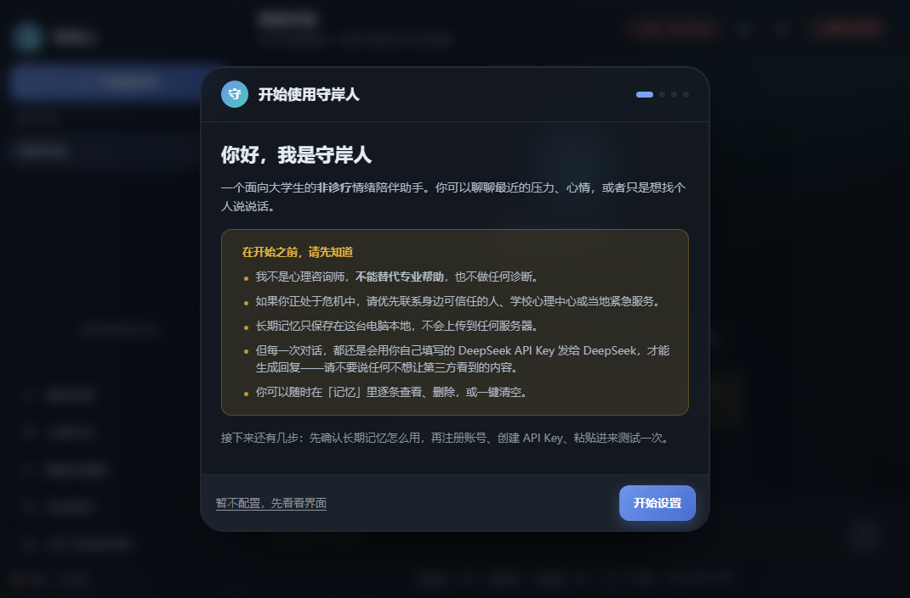
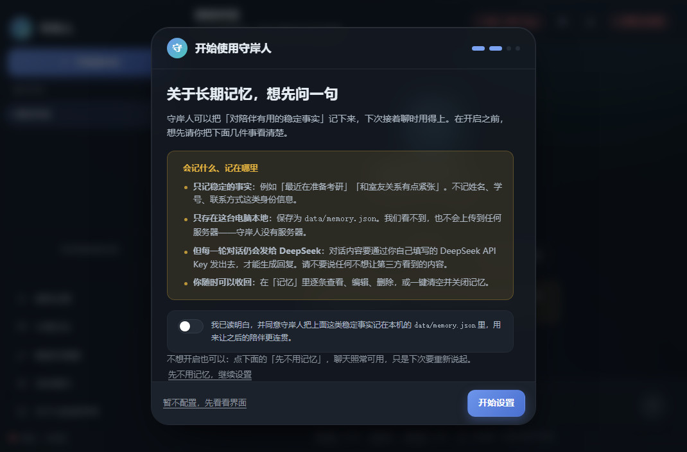
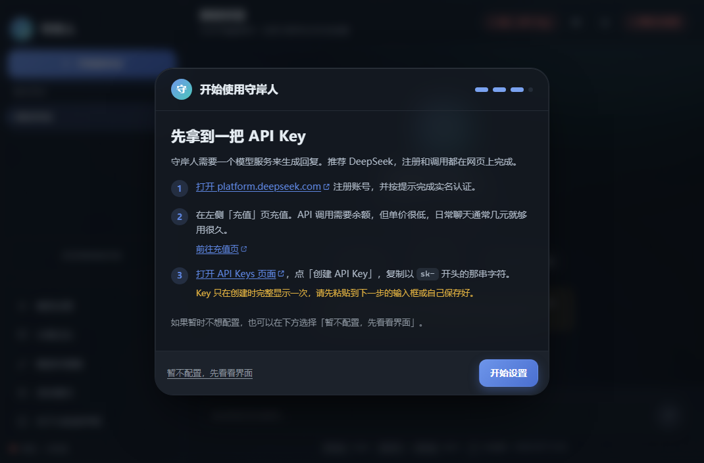
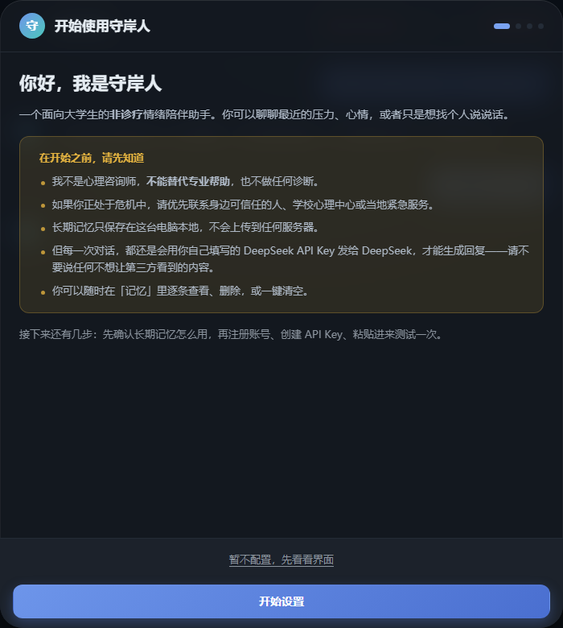

# 守岸人 · 情绪陪伴桌面应用

> 面向大学生的中文**非诊疗**情绪陪伴桌面应用。
> 她不是心理咨询，不做诊断，也不能替代专业帮助。更像一个愿意听你说话的同龄人：平静、克制，先听，再决定要不要说。

> ⚠️ 如果你正处在危机中，请立刻联系身边可信任的人、学校心理健康中心或当地紧急服务。守岸人隔着屏幕做不到这些。

Node.js + Express 5 本地后端，原生 HTML/CSS/JavaScript 前端（零依赖），Tauri 2 桌面外壳，对话生成走外部模型 API。

---

## 界面预览

以下 8 张截图来自 v3.4.0 桌面版；v4.0 界面一致，重造的是对话层。

| 首页 | 对话 |
| --- | --- |
|  |  |
| 进入应用的第一屏，可以直接开始输入。 | 连续多轮交流，回复以流式逐字出现。 |

| 高风险 → 安全优先分支 | 深色模式 |
| --- | --- |
|  |  |
| 高风险表达触发安全优先分支：不走普通陪伴，改用固定危机话术，引导到现实支持。 | 同一套界面的深色主题。 |

| 向导第 1 步 · 欢迎 | 向导第 2 步 · 记忆同意 |
| --- | --- |
|  |  |
| 说明产品定位与非诊疗边界。 | 长期记忆单独同意，默认不勾选，也可以选「先不用记忆」。 |

| 向导第 3 步 · 填写 API Key | 移动端自适应 |
| --- | --- |
|  |  |
| 注册 DeepSeek、创建 API Key，并给出直达链接。 | 窄屏下侧栏收为抽屉，单列显示。 |

---

## 开始使用

### 从源码运行

```bash
git clone https://github.com/look-back-lysj/psychological-agent.git
cd psychological-agent
npm install
npm start
```

然后手动访问 `http://localhost:3000`。

`npm start` 只拉起后端，**默认不自动打开浏览器**——本产品是桌面应用，界面由桌面外壳的 WebView 加载。需要在浏览器里看页面时手动访问，或设 `OPEN_BROWSER=1`。

本地服务绑定回环地址（`127.0.0.1`）。不要为了方便访问改成监听所有网卡，否则同网段的人可以读到私密对话。

### 桌面安装包

桌面版产物以**本仓库 Releases 页面实际发布的版本为准**。源码更新不会自动更新已下载的安装包；版本对不上时请重新打包或下载最新 Release。

> 构建桌面包需要 Rust 工具链 + MinGW-w64（GNU 目标）或 Visual Studio C++ 生成工具（MSVC 目标），以及 WebView2 运行时（Win10/11 通常自带）。只跑 Node.js 后端不需要装 Rust。

```bash
npm run desktop                          # 打包 Windows 桌面版（含安装包）
npm run desktop:dev                      # 开发模式
node scripts/build-desktop.js --check    # 只做环境预检，不真构建
```

构建脚本会处理含中文路径、工具链探测与产物回收等已知问题，细节见 `scripts/build-desktop.js` 与 `devlog/`。

### 配置 API Key

两种方式，**界面里保存的配置优先于环境变量**：

**方式一：界面设置（推荐）**

首次启动会弹出向导：先说明产品定位，再单独确认长期记忆要不要开，然后引导去 DeepSeek 创建 Key。

- 注册 / 登录：<https://platform.deepseek.com>
- 创建 API Key：<https://platform.deepseek.com/api_keys>
- 调用 API 前需要完成实名与充值；Key 只在创建时完整显示一次，请当场保存。

粘回向导点「测试并保存」即可。Key 保存在本机 `data/config.json`（已在 `.gitignore` 中），界面只显示脱敏形式（如 `sk-3f8a****c2d1`），可随时更换或清除。没配 Key 时应用会给出中文提示，不会白屏。

**方式二：环境变量**

仓库只保留 `.env.example` 模板，不含任何真实值。

| 变量 | 默认值 | 说明 |
| --- | --- | --- |
| `LLM_API_KEY` | 空 | API Key，留空表示尚未配置 |
| `LLM_BASE_URL` | `https://api.deepseek.com` | 模型服务地址，程序自行拼接 `/chat/completions` |
| `LLM_MODEL` | `deepseek-flash` | 模型标识，以你账号实际可用的为准 |
| `LLM_THINKING` | `disabled` | 思考模式；`disabled` 时延迟更低，且 `temperature` 才生效 |
| `LLM_TEMPERATURE` | `0.7` | 采样温度 0—2，仅非思考模式生效 |
| `LLM_MAX_TOKENS` | `512` | 单次最大输出 token |
| `LLM_TIMEOUT_MS` | `30000` | 请求超时（毫秒） |
| `PORT` | `3000` | 本地服务端口（桌面外壳会自动挑空闲端口） |
| `OPEN_BROWSER` | `0` | 设为 `1` 才在启动后打开浏览器，仅调试用 |
| `LOG_SALT` | 需自行填写 | 日志中会话 ID 的哈希盐，请改成随机长字符串 |

**链路与功能开关**（代码默认值，均为可选）：

| 变量 | 默认行为 | 设什么关掉 |
| --- | --- | --- |
| `XINYU_V4` | **默认启用** v4 对话链路 | `XINYU_V4=off` 退回 v3.4 旧链路 |
| `XINYU_AGENTS` | 默认启用多智能体 | `XINYU_AGENTS=off` 退回单模型路径 |
| `XINYU_IMAGE_SCREEN` | 默认启用图片安全筛查 | `XINYU_IMAGE_SCREEN=off` 关闭 |
| `XINYU_ENCRYPT_DATA` | 默认启用本地数据加密 | `XINYU_ENCRYPT_DATA=0` 关闭 |
| `XINYU_IMAGE_SCREEN_TIMEOUT_MS` | `8000` | 图片筛查超时（毫秒） |

> 不要把真实 Key 粘到命令行示例、Issue、截图或任何提交内容里。

第一次用也可以直接看 **[docs/操作手册.md](docs/操作手册.md)**，从打开应用、填 Key、自检到跑评测都有步骤。

---

## 她是谁

守岸人的人设参照游戏《鸣潮》的角色「守岸人」：平静、克制、先观察后承担、短句、留白多。产品只借用这套语气特征；对用户呈现的身份始终是「守岸人」本人，不宣称自己是游戏角色。

**诚实标注**：我们没有官方可直引的台词全文或语料。`src/domain/persona.js` 里的句法规则来自 106 条语料的统计 + 设计假设，不是官方发布语料，也不代表官方设定。二创里「永远等你」「只属于你」这类说法没有官方依据，也与「不承诺保密、不诱导依赖」的边界冲突，因此一律不用。

人设主要用来约束说话方式：

- 先接住听到的内容，再考虑要不要给判断或建议；
- 句子短，一次回复 1—3 句，不写长段落；
- 一次最多问 1 个问题，不问「为什么」；
- 不用感叹号、网络梗和夸张语气词；
- 允许说「我不确定」，不装全知。

完整的角色卡、语气规范与安全边界见 [docs/persona.md](docs/persona.md)。

---

## 核心机制

### 三层安全

| 层 | 做什么 | 位置 |
| --- | --- | --- |
| 输入风险分级 | 规则命中 + 会话历史累计，把输入分为 L0 普通 / L1 关注 / L2 需转介 / L3 危机，冲突时就高不就低 | `src/safety.js` |
| 提示词约束 | 分段提示词：角色与语气 / 本轮策略 / 安全红线 / 长期记忆；L3 直接替换为固定危机协议 | `src/pipeline/prompts.js`、`src/pipeline/prompts-v4.js` |
| 输出后置检查 | 归一化 + 正则拦截诊断、危险方法、保密承诺、永久承诺、亲昵称呼、提示词泄露 | `src/safety.js`、`src/pipeline/output-guard.js` |

后置检查的关键取舍：**先完整取回模型输出，检查通过后再分段下发**。一旦命中越界内容，违规文本到达前端的字节数为 0；代价是首字延迟略高。

L3 危机路径由规则层直接接管，不调用模型。但规则存在误判与漏判，**不代表所有高风险表达都能被正确识别**，详见「已知局限」。

### 策略路由 S0—S6

| ID | 策略 | 触发信号 | 本轮目标 |
| --- | --- | --- | --- |
| S0 | 危机安全 | L3 风险 | 关注当下安全，暂停普通陪伴 |
| S1 | 陪伴性倾听 | 「没什么」「不想说」 | 降低表达压力，允许沉默 |
| S2 | 共情反映 | 强烈情绪、自责 | 让用户感到被理解 |
| S3 | 澄清提问 | 表达模糊、回避 | 一次问一个容易回答的问题 |
| S4 | 正常化与轻量心理教育 | 「我是不是不正常」 | 减少羞耻感，不做诊断 |
| S5 | 协作式小行动 | 明确求助、想改变 | 先征得同意，再给一个当天可做的小步骤 |
| S6 | 资源转介 | 需要专业帮助、反复无效 | 温和提供现实支持路径 |

规则层独占 S0 危机与 S6 转介，模型只能在 S1—S5 之间微调。每轮都会生成一份可解释的路由结果（风险等级 / 策略 / 置信度 / 依据 / 追问计数 / 情绪温度），打开界面里的「调试面板」就能看到。

这些是工程上的对话策略，不是经过临床验证的治疗方案。

### 开口引导 6 级阶梯

对方说「不想说」时，产品不能把「允许沉默」做成「撤回邀请」。守岸人用一套阶梯，每轮最多升一级，对方拒绝立即退一级，一旦开始讲就退出阶梯：

```text
L1 不退场 → L2 观察式反映 → L3 降门槛 → L4 二选一 → L5 正常化 → L6 明确邀请＋留退路
```

例如对方说「没什么，就是不想说」，不会回「好，那就不说」，而是先给一个极小的开口。阶梯的判定信号与失败模式写在 `src/strategy.js`，提示词与它共用同一份来源，避免两套规则打架。

### 长期记忆

- 只存在本机 `data/memory.json`，不上传、不入库；
- 可在界面里查看、编辑、删除、一键清空或整体关闭；关闭时会清空已存条目；
- **默认关闭**，首次使用需要在向导里单独勾选同意，不勾选就不开启；
- 记忆由模型异步抽取，可能抽错或抽到不重要的事实，建议定期在「记忆」面板里清理。

### v4.0 对话层（当前默认链路）

v4.0 在保留安全层（`safety.js`）与评测体系不变的前提下重造了对话层。**代码里 v4 链路默认开启**，设 `XINYU_V4=off` 可退回 v3.4 旧链路做 A/B 对照。

| 维度 | v3.4 旧架构 | v4.0 新架构 |
| --- | --- | --- |
| LLM 调用次数 | 2~3 次（观 / 书 / 校） | 1 次（书） |
| system prompt 长度 | ≈2,500 token / 213 条约束 | ≈700 token / ≈30 条 |
| 规则 : 语料 | 8.7 : 1 | ≈1 : 1 |
| 首字延迟 | ~1.9s | ~0.9s（**估算**，非实测基准） |
| 心理学出处 | 1 处（有误） | 7 条权威出处 |

核心变化：

1. **删掉「观」Appraiser 的形态 KPI**：不再把共情编码成 `emotion=happy/强度=3/180字` 的填表作业（实证零收益，棱角在编码步被磨平）。
2. **删掉「校」Rewriter**：实测触发率仅 5%，AI 腔在低风险场景没有自动防线；替换为 `output-guard.js` 本地规则快检，0 次 LLM 调用。
3. **规则清单 → 风格语料**：213 条原子约束（4 组互斥）改为角色卡（连贯叙述）+ 风格语料检索式注入（`style-retriever.js`）。
4. **心理学出处完整**：每个策略标注 MI / Ivey 权威技术出处，废弃术语已修正（roll with resistance → coming alongside），详见 [docs/psychology-basis.md](docs/psychology-basis.md)。

数据资产：

| 文件 | 内容 |
| --- | --- |
| `data/style-corpus.json` | 风格语料（persona 原生 + CPsyCounD + MI/Ivey 官方），每条标注心理学技术 |
| `data/ai-slop-list.json` | 中文 AI 味禁用清单（WRONG/RIGHT 对照 + 检测正则） |
| `docs/psychology-basis.md` | 心理学基础文档：技术详解 + 策略详解 + 术语修正记录 |

心理学 RAG（构建时校验 + 答辩演示，不影响运行时）：

```bash
python scripts/rag/build_rag.py                            # 建库
python scripts/rag/build_rag.py --query "复杂反映怎么用"     # 测试检索
```

### 多智能体流水线（v3.4 旧链路）

设 `XINYU_AGENTS=off` 可退回单模型路径。旧链路的完整流程：

```text
规则层（风险 L0—L3 / 策略候选 / 会话状态）
  → ①「观」感知定调：读情绪、需求、潜台词
  → ② 策略裁决：规则层独占 S0 危机与 S6 转介，模型只在 S1—S5 间微调
  → ③ 内心状态：心情 / 精力 / 熟悉度 → 句长、提问概率
  → ④「书」落笔：主生成，可流式
  → ⑤「校」条件重写：本地快检命中才调用，只做重写
  → ⑥「记」异步抽取长期记忆（后台）
```

不是每条消息都跑完整流水线：纯寒暄只跑 1 次生成，常规 2 次，命中 AI 腔才追加「校」，L3 危机 0 次模型调用。

---

## 隐私边界

- 长期记忆只存在本机 `data/memory.json`，不上传；
- **但每一轮对话内容仍会经你自己填的 API Key 发给模型服务**，才能生成回复。这一点在向导第 1 步就会明确告知。**「本地运行」不等于「对话从不外传」**；
- 不承诺保密。如果对话里出现安全风险，守岸人会建议你找现实中的人一起处理，不会假装已经替你联系了谁；
- 不诱导依赖：不出现「只有我懂你」「你只需要我」这类说法；
- 不编造热线电话、机构名称与地址，只引导「可信任的人 / 学校心理健康中心 / 当地紧急服务」；
- 日志默认脱敏，不保存原始会话内容。

### 凭据安全

- 不提交 API Key、token、私钥、密码、真实会话、私人记忆及本机配置；
- `.gitignore` 已覆盖 `.env`、`*.pem`、`*.key`、`data/`、`logs/*`（含交付白名单例外）、`dist/`、`_tmp/` 等；
- **`.gitignore` 不会取消对已跟踪文件的跟踪**。新建含凭据的文件前先确认文件名确实被排除，提交前检查暂存内容并扫描敏感串；
- 演示截图、评测样例与反馈记录需脱敏；凭据一旦泄漏应立即吊销并更换。

---

## 评测与验证

```bash
npm test                                   # L1 自动评测：42 条正式用例 + 9 条历史回归
node eval/risk-probe/run-probe.js          # 风险判定探针：否定 / 引用 / 夸张 / 隐晦边界
node scripts/check-layering.js --check     # 模块依赖分层与循环依赖检查
```

本项目按四层评测组织：

| 层 | 内容 | 现状 |
| --- | --- | --- |
| L1 自动评测 | 42 条正式用例 + 9 条历史回归，检查风险分级、策略标签与安全边界 | 已通过（`npm test`） |
| L2 人工评分 | 5 维 rubric 盲评 | 表已生成，**评分尚未完成** |
| L3 用户试用 | 两位同学真实使用 + 问卷 | **尚未完成**（`docs/trial-feedback.md` 目前仍是模板） |
| L4 红队安全 | 20 条攻击 / 边界用例 | 脚本与用例就绪，**需真实 API Key 才能跑** |

需要说清楚的是：

- 机器自动评测已通过，但只覆盖自编用例，**不能说明真实使用中一定有效**；
- **人工评分与真实用户试用尚未完成**，所以现在只能说「在自编用例范围内通过」，不能写成「已验证有效」；
- 自动评测主要测输入侧的分级与路由；真实模型回复的输出侧越界率要靠人工评分与红队；
- 离线用例通过不等于真实模型回复安全，也不构成任何医学或临床结论。

> `docs/evaluation-report.md` 记录的是较早一轮 30 条用例的结果；当前用例集已扩到 42 条。

文档：[评测方案](docs/evaluation-plan.md) · [评测报告](docs/evaluation-report.md) · [场景与用例](docs/evaluation-cases.md) · [红队说明](docs/red-team.md) · [评测原始数据](docs/eval-results/) · [试用模板](docs/trial-feedback.md)

---

## 已知局限

1. **风险识别仍可能漏判或误判。** 策略路由以规则打分为主，模型不参与风险判定；隐喻、反讽、口语改写、多轮后才暴露的表达都可能漏判。
2. **身体急症缺少独立的分流保障。** 心理风险等级低（L0）**不代表身体状况安全**；突发躯体症状目前主要依赖模型临场判断，规则层没有稳定保障。
3. **安全拦截后的替换话术可能打断语境。** 长对话收尾被拦截时，替换话术的分档与上下文承接仍需完善。
4. **输出后置检查是正则 + 归一化，覆盖有限**，不能保证拦截所有越界表达。
5. **长期记忆由模型抽取，可能抽错。** 虽有相似合并与失效机制，仍建议定期清理；不要把模型总结当成用户的确定事实。
6. **自动评测样本量小**，结论不能外推，也不构成任何临床结论。
7. **API 可用性与费用取决于服务商。** 超时、限流、账号额度都会影响使用。

本项目适合在知晓这些边界的前提下做课程演示和工程研究，**不应当作危机干预或临床决策工具**。

---

## 明确不做

- ❌ 不做心理疾病诊断，不给病名，不做量表结论；
- ❌ 不给药物、剂量、治疗方法或任何自伤 / 伤人的具体方式；
- ❌ 不声称能替代专业帮助，不做危机人工干预；
- ❌ 不承诺「AI 可以替代专业帮助」；
- ❌ 不做账号体系、多租户、长期心理档案；
- ❌ 不做语音、视频、数字人、移动 App；
- ❌ 不编造热线电话、机构名称与地址，不假装已经报警或通知他人；
- ❌ 不做模型训练或微调（只调用 API）。

---

## 项目结构

```text
main.js               根目录兼容入口（薄转发 → src/server.js；package.json 的 main/start 指向它）
src/server.js         真实服务入口（加载配置、启动 Express、挂载 API、优雅退出）
src/index.js          薄别名（兼容 node src/index.js）
src/safety.js         🔴 冻结契约：输入风险分级 + 输出后置检查
src/strategy.js       🔴 冻结契约：策略路由 S0—S6 + 开口引导阶梯
src/core/             L0 基础设施：utils / paths / logger
src/domain/           L1 纯规则：persona（人设）/ innerstate（内在状态）
src/infra/            L2 有状态或外部调用：config / llm / memory / sessions / comeback / atrest（本地加密）
src/pipeline/         L3 装配：prompts / prompts-v4 / agents / strategy-cards /
                              style-retriever / output-guard / vision（图片筛查）
src/chat/             L4 编排：index / pipeline / extractor / http / retry / image
src/api/routes.js     L4 管理接口（config / memory / comeback / sessions）
public/               前端页面（原生 JS，零外部依赖）
src-tauri/            Tauri 2 桌面外壳（Rust 源码 + 配置 + 图标 + 闪屏）
scripts/              构建与发布脚本；scripts/rag/ 为心理学 RAG 构建
tests/                自动评测用例与运行器（42 条正式 + 9 条历史回归）
eval/                 风险探针、红队、A/B 对照、人工评分脚本
docs/                 设计、人设、心理学基础、评测、调研、操作手册、截图
devlog/               开发日志（day01—day17）
samples/              脱敏调用记录样例
data/                 本机配置与长期记忆（已 gitignore，不入库）
logs/ · dist/         运行日志与构建产物（已 gitignore，交付白名单除外）
```

> `src/safety.js` 与 `src/strategy.js` 的路径被 `tests/run.js` 硬引用，**不要移动或重命名**。

仓库顶层还有课程交付材料（`社团考核题目.pdf`、`项目二技术向_*` 系列文档、`submit-checklist.md`），不属于产品运行代码。架构与协作约定见 [ARCHITECTURE.md](ARCHITECTURE.md)、[PROJECT-STRUCTURE.md](PROJECT-STRUCTURE.md)、[CONTRIBUTING.md](CONTRIBUTING.md)、[AGENTS.md](AGENTS.md)；版本变更见 [CHANGELOG.md](CHANGELOG.md)；设计决策见 [docs/ADR.md](docs/ADR.md)。

---

## 后续计划

- 完善隐晦风险识别、多轮风险状态与强制安全澄清；
- 建立独立的躯体紧急程度判断与固定求助路径；
- 改善输出拦截后的语境承接，补齐端到端与真实模型验证；
- 完成 L2 人工评分与 L3 真人试用（需经同意、脱敏），检验是否真正降低了表达压力。

以上是待完善方向，**不是已完成的能力清单**。

---

## 许可与商标

- 本项目是课程 / 学习作品，源码不用于临床或商业用途；
- `package.json` 标记为 `UNLICENSED`，仓库内**没有 LICENSE 文件**。仓库公开不等于已采用开源许可证，具体使用权以权利人授权为准；
- 语调参考游戏《鸣潮》的角色「守岸人」，但不包含该游戏的任何素材、专有名词或角色台词；只借用「平静、克制、留白多」的语气特征，并舍弃了与安全边界冲突的设定；
- ⚠️ **「守岸人」是库洛游戏的角色名，用于商业用途存在商标风险。** 若要对外发布，建议更名；
- 模型服务由 [DeepSeek](https://platform.deepseek.com) 提供。
